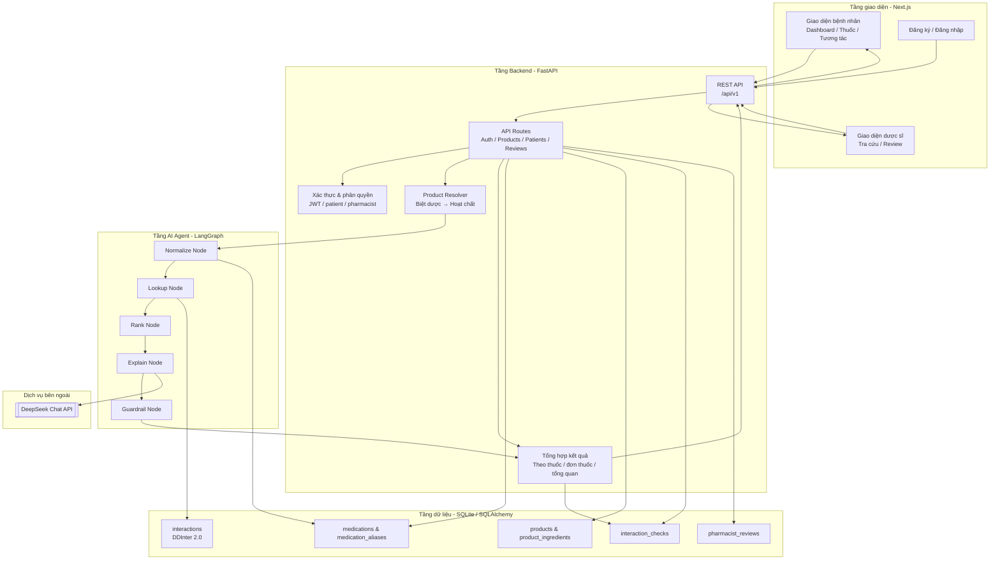
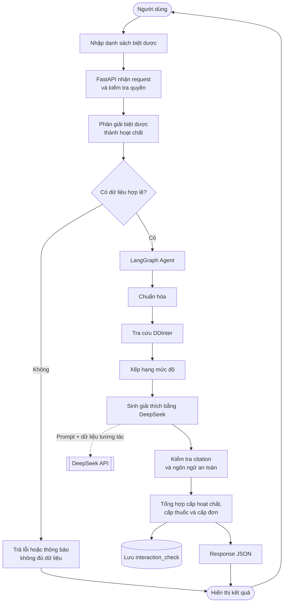
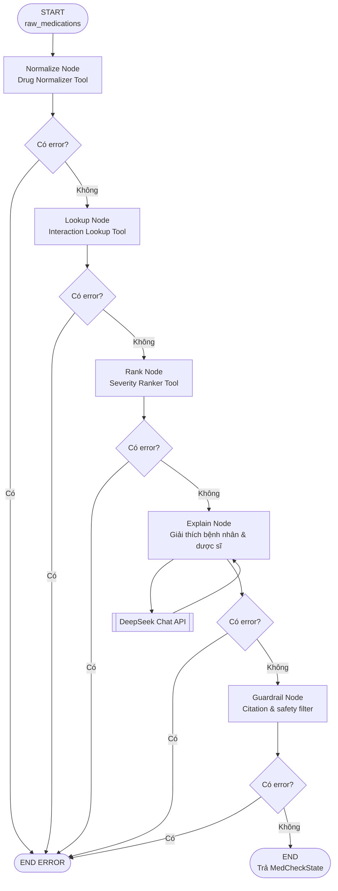
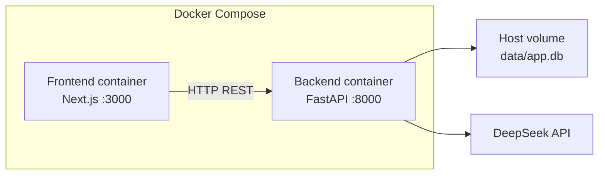

# Architecture Document — MediCheck

## 1. Tổng quan hệ thống

MediCheck là hệ thống hỗ trợ kiểm tra tương tác thuốc cho bệnh nhân và dược sĩ. Người dùng nhập tên biệt dược trên giao diện Next.js; backend FastAPI phân giải biệt dược thành hoạt chất, sau đó chạy LangGraph Agent để chuẩn hóa, tra cứu dữ liệu DDInter 2.0, xếp hạng mức độ và sinh giải thích tiếng Việt.

Kết quả được kiểm tra bằng guardrail, tổng hợp theo cấp hoạt chất và cấp thuốc, trả về frontend dưới dạng JSON. Với luồng bệnh nhân, kết quả kiểm tra được lưu vào SQLite để xem lại lịch sử và phục vụ quy trình dược sĩ xác nhận.

## 2. Kiến trúc hệ thống

## 3. Các component chính

### 3.1 Frontend — Next.js 14

- **Mục đích:** Cung cấp giao diện web cho bệnh nhân và dược sĩ.
- **Các màn hình chính:** landing page, đăng ký/đăng nhập, dashboard bệnh nhân, hồ sơ thuốc, kiểm tra tương tác, dashboard dược sĩ, tra cứu và review.
- **Giao tiếp backend:** gọi REST API qua `frontend/lib/api.ts`.
- **Session:** lưu access token và thông tin vai trò ở phía client qua `frontend/lib/auth.ts`.
- **Chạy local:** container frontend chạy Next.js development server tại cổng `3000`.

### 3.2 Backend — FastAPI

- **Mục đích:** Cung cấp API, xác thực, phân quyền, xử lý dữ liệu và điều phối agent.
- **Entry point:** `src/main.py`.
- **Routes:** `src/api/routes.py`.
- **Prefix API:** `/api/v1`.
- **Xác thực:** Bearer JWT; role gồm `patient` và `pharmacist`.
- **Validation:** Pydantic schemas trong `src/models/schemas.py`.
- **Database dependency:** SQLAlchemy session trong `src/db/session.py`.

Các nhóm API chính:

- `/auth/register`, `/auth/login`: đăng ký và đăng nhập.
- `/products/search`, `/products/check`: tìm kiếm và kiểm tra theo tên biệt dược.
- `/guest/products/check`: kiểm tra không cần đăng nhập.
- `/patients/{patient_id}/...`: hồ sơ thuốc và lịch sử bệnh nhân.
- `/pharmacist/...`: danh sách yêu cầu, xem chi tiết và xác nhận review.

### 3.3 AI Agent — LangGraph

Agent được xây dựng trong `src/agents/graph.py` với state schema tại `src/agents/state.py`. Luồng hiện tại là pipeline 5 node nối tiếp:

1. `normalize`: chuẩn hóa tên thuốc/alias thành hoạt chất và medication ID.
2. `lookup`: tra cứu các cặp hoạt chất trong bảng tương tác DDInter.
3. `rank`: xếp hạng mức độ `nhe`, `trung_binh`, `nang` hoặc `chua_phan_loai`.
4. `explain`: tạo giải thích cho bệnh nhân và dược sĩ; các trường hợp có dữ liệu mức độ sẽ gọi DeepSeek.
5. `guardrail`: kiểm tra citation và lọc ngôn ngữ không an toàn như tự ý ngừng/đổi thuốc.

Mỗi node ghi kết quả vào `MedCheckState`. Nếu state có `error`, graph kết thúc sớm; nếu không, graph chuyển sang node kế tiếp.

### 3.4 Agent tools

- `drug_normalizer_tool.py`: tìm thuốc chuẩn và alias trong database.
- `interaction_lookup_tool.py`: tìm cặp tương tác theo medication ID.
- `severity_ranker_tool.py`: chuẩn hóa và tổng hợp mức độ cảnh báo.

### 3.5 Database — SQLite và SQLAlchemy

Database development mặc định là `data/app.db`, được mount vào backend container. Các bảng chính:

- `users`: tài khoản, mật khẩu hash và vai trò.
- `patient_profiles`: thông tin hồ sơ bệnh nhân.
- `medications`: thuốc/hoạt chất chuẩn từ DDInter.
- `medication_aliases`: tên viết tắt, biệt danh và alias.
- `products`: tên biệt dược.
- `product_ingredients`: liên kết biệt dược với hoạt chất.
- `interactions`: cặp tương tác, mức độ, mô tả và nguồn trích dẫn.
- `interaction_checks`: kết quả kiểm tra được lưu cho bệnh nhân.
- `pharmacist_reviews`: yêu cầu và trạng thái xác nhận của dược sĩ.

### 3.6 DeepSeek LLM

`src/services/llm.py` khởi tạo `ChatOpenAI` với `base_url` của DeepSeek. API key và model được đọc từ `.env`. LLM chỉ sinh phần giải thích dựa trên dữ liệu tương tác đã tra cứu; dữ liệu nguồn DDInter vẫn được lưu và trả về trong kết quả.

## 4. Data Flow — Luồng dữ liệu

## 5. Agent Flow — Luồng xử lý LangGraph

## 6. Deployment Architecture

`docker-compose.yml` chạy hai service là `frontend` và `backend`. Database SQLite nằm trên host và được mount vào backend; vì vậy `docker compose down` không xóa file `data/app.db`.

## 7. Security

- API key chỉ lưu trong `.env`, không commit vào Git.
- Mật khẩu được hash trước khi lưu vào database.
- API dùng Bearer JWT để xác định người dùng.
- Role-based access control giới hạn endpoint bệnh nhân và dược sĩ.
- Pydantic kiểm tra request/response schema.
- CORS được cấu hình trong `src/main.py`.
- Guardrail chặn nội dung khuyến nghị tự ý đổi, ngừng hoặc điều chỉnh thuốc.
- Thông tin chuyên môn như `xu_tri`, `thay_the_a`, `thay_the_b` được giới hạn cho luồng dược sĩ.

## 8. Design Decisions

| Quyết định   | Lựa chọn                        | Lý do                                                                |
| ------------ | ------------------------------- | -------------------------------------------------------------------- |
| Backend      | FastAPI                         | Async, có Swagger tự động và tích hợp tốt với Pydantic               |
| Frontend     | Next.js 14                      | App Router, TypeScript và phù hợp xây dựng giao diện nhiều vai trò   |
| Agent        | LangGraph                       | Quản lý state và pipeline nhiều node rõ ràng                         |
| Database     | SQLite + SQLAlchemy             | Đơn giản cho MVP local, dữ liệu DDInter được truy vấn trực tiếp      |
| LLM          | DeepSeek qua `langchain-openai` | Sinh giải thích tiếng Việt với API tương thích OpenAI                |
| Deployment   | Docker Compose                  | Chạy frontend và backend nhất quán trên máy demo                     |
| Human review | Pharmacist review workflow      | Kết quả cảnh báo được dược sĩ xem xét trong quy trình hỗ trợ an toàn |

## 9. Giới hạn hiện tại

- Hệ thống hiện chạy local bằng SQLite; PostgreSQL dành cho giai đoạn triển khai production.
- Chưa có giao diện admin để gán dược sĩ cho bệnh nhân; một số dữ liệu assignment cần thao tác thủ công.
- Agent graph hiện là pipeline 5 node; guardrail kết thúc bằng success/error, chưa có vòng lặp rewrite tự động trong LangGraph.
- ChromaDB có service module nhưng chưa được sử dụng trong luồng kiểm tra tương tác chính.
