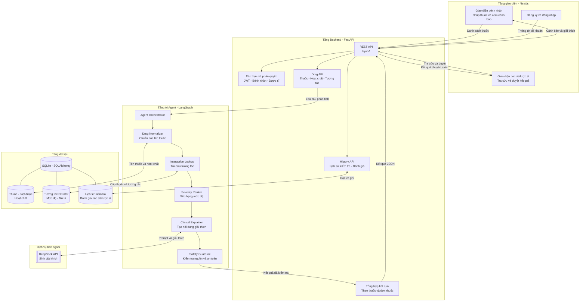
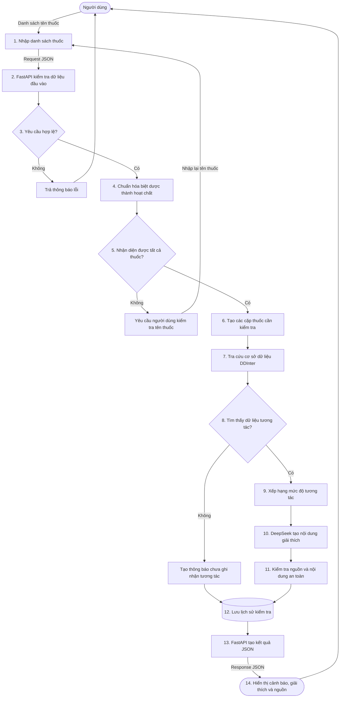
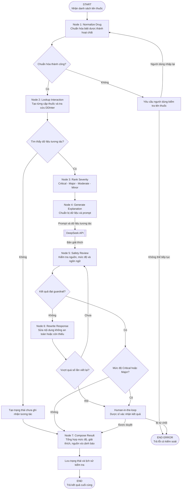

# ARCHITECTURE DIAGRAMS — MEDICHECK

## 1. System Architecture Diagram — Kiến trúc hệ thống

Sơ đồ thể hiện các thành phần chính của hệ thống và kết nối giữa tầng giao diện, backend, AI Agent, cơ sở dữ liệu và dịch vụ AI bên ngoài.

## 2. Data Flow Diagram — Luồng dữ liệu

Sơ đồ mô tả dữ liệu từ lúc người dùng nhập danh sách thuốc đến khi hệ thống trả về cảnh báo, giải thích và nguồn tham khảo.

## 3. Agent Flow Diagram — Luồng xử lý của LangGraph Agent

Sơ đồ thể hiện các node, điều kiện rẽ nhánh, vòng lặp sửa kết quả và bước Human-in-the-loop trong AI Agent.

## Mô tả ngắn

- **System Architecture Diagram:** mô tả các thành phần và kết nối trong toàn bộ hệ thống MediCheck.
- **Data Flow Diagram:** mô tả hướng di chuyển và quá trình biến đổi dữ liệu.
- **Agent Flow Diagram:** mô tả chi tiết các node, conditional edges, vòng lặp và Human-in-the-loop của LangGraph Agent.
