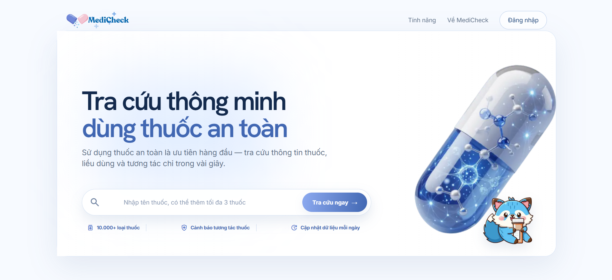
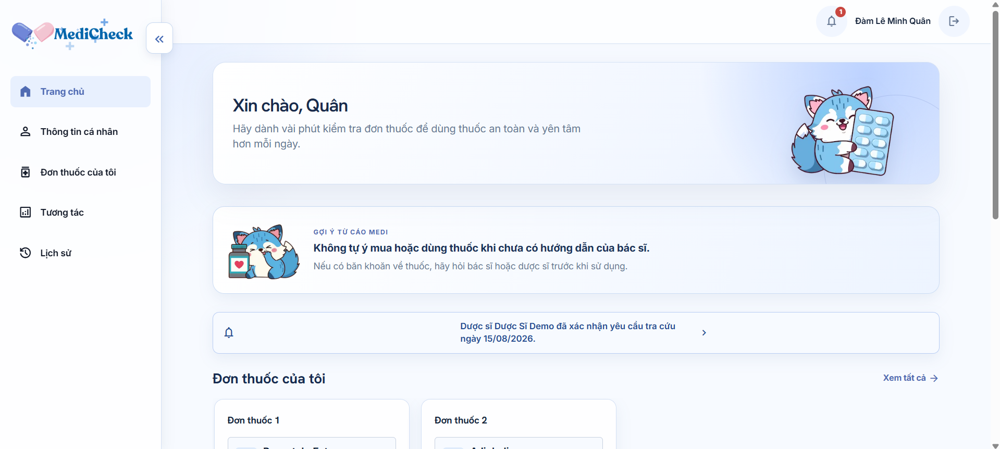
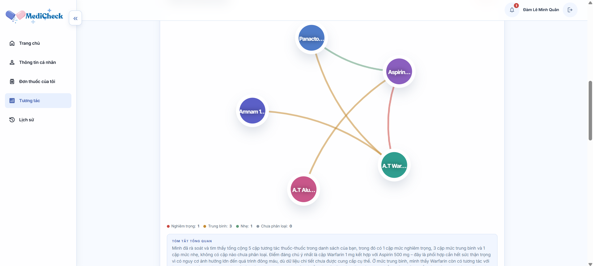
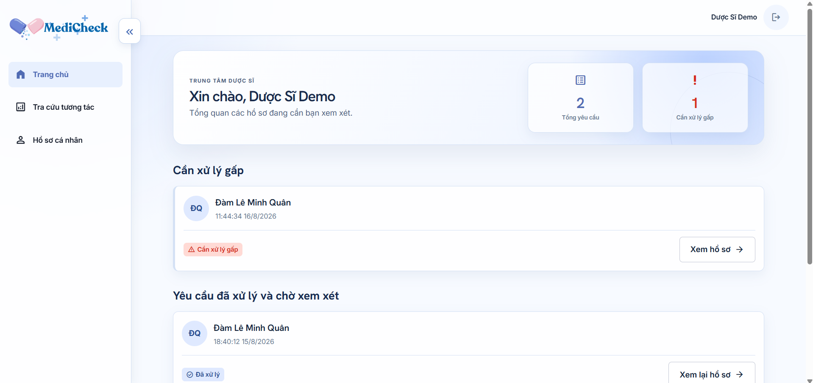

# 🛡️ MediCheck — VMEC-12

> AI Agent kiểm tra tương tác thuốc & cảnh báo an toàn dùng thuốc cho bệnh nhân và dược sĩ, dựa trên dữ liệu thật **DDInter 2.0**.

Bệnh nhân dùng nhiều thuốc/thực phẩm chức năng cùng lúc dễ gặp tương tác nguy hiểm mà không biết. MediCheck nhận danh sách thuốc, chuẩn hóa tên, tra cứu tương tác qua CSDL DDInter 2.0 thật (1503 thuốc / 15140 cặp tương tác), xếp hạng mức độ nghiêm trọng, giải thích bằng tiếng Việt kèm trích dẫn nguồn — và luôn có dược sĩ xác nhận (HITL) trước khi coi là đáng tin.

**AI không tự chẩn đoán, không tự khuyên đổi/ngừng thuốc — mọi cảnh báo chỉ mang tính tham khảo.**

## Screenshot

| Landing page | Dashboard bệnh nhân |
|---|---|
|  |  |

| Kết quả kiểm tra tương tác | Dashboard dược sĩ |
|---|---|
|  |  |

## Tech Stack

| Layer | Công nghệ |
|---|---|
| Agent | LangGraph + LangChain, 5 node (chuẩn hóa → tra cứu → xếp hạng → giải thích → guardrail) |
| LLM | DeepSeek-chat (qua `langchain-openai` trỏ base_url DeepSeek) |
| Backend | FastAPI + Uvicorn + SQLAlchemy |
| Database | SQLite (dev) / PostgreSQL (prod) |
| Dữ liệu tương tác thuốc | DDInter 2.0 thật (không phải mô phỏng) |
| Frontend | Next.js 14 (App Router) + TypeScript, 2 vai trò (bệnh nhân/dược sĩ) |
| Testing | pytest + pytest-asyncio + httpx |

## Cài đặt & Chạy

Setup bằng **Docker** — không cần cài Python/Node trên máy, chỉ cần Docker. Chạy được trên **Windows, macOS, Linux**.

### 0. Cài Docker

- **Windows**: cài [Docker Desktop](https://www.docker.com/products/docker-desktop/), bật WSL2 backend khi được hỏi (mặc định).
- **macOS**: cài [Docker Desktop](https://www.docker.com/products/docker-desktop/).
- **Linux**: cài [Docker Engine](https://docs.docker.com/engine/install/) + plugin Compose.

Kiểm tra đã cài đúng:

```bash
docker --version
docker compose version
```

### 1. Lấy code

```bash
git clone <repo-url>
cd P-005
```

### 2. Đặt file dữ liệu `app.db`

File `data/app.db` (~280MB, đã seed sẵn 1503 thuốc + 15140 cặp tương tác DDInter 2.0) quá nặng nên không nằm trong git — nhận qua kênh riêng, copy vào đúng đường dẫn `data/app.db` (cùng cấp với `Dockerfile`).

Không có file này, backend vẫn khởi động được nhưng mọi tra cứu thuốc sẽ trả "không có dữ liệu".

### 3. Tạo file cấu hình `.env`

```bash
cp .env.example .env
```

Điền các biến bắt buộc — xem bảng đầy đủ ở mục [Environment Variables](#environment-variables) bên dưới.

### 4. Build & chạy toàn bộ hệ thống

```bash
docker compose up --build
```

Build 2 image (backend FastAPI + frontend Next.js) và chạy cùng lúc. Chạy nền (không giữ terminal): thêm `-d`.

### 5. Kiểm tra đã chạy đúng

- Backend health check: [http://localhost:8000/health](http://localhost:8000/health) → phải thấy `{"status":"ok",...}`.
- Swagger UI: [http://localhost:8000/docs](http://localhost:8000/docs).
- Frontend: [http://localhost:3000](http://localhost:3000).

### 6. Dừng hệ thống

```bash
docker compose down
```

Không xóa `data/app.db` (được mount từ máy thật qua volume).

## Environment Variables

Chỉ liệt kê tên biến — giá trị thật nằm trong `.env` (không commit vào git).

| Biến | Bắt buộc | Mô tả |
|---|:---:|---|
| `DEEPSEEK_API_KEY` | ✅ | API key DeepSeek (free tại [platform.deepseek.com](https://platform.deepseek.com)). Không có key này, các cặp thuốc mức nhẹ/trung bình/nặng sẽ không sinh được giải thích (agent cần gọi LLM thật). |
| `DEEPSEEK_BASE_URL` | — | Mặc định `https://api.deepseek.com`, không cần đổi. |
| `MODEL_NAME` | — | Mặc định `deepseek-chat`. |
| `DATABASE_URL` | — | Mặc định `sqlite:///./data/app.db`, khớp với file ở bước 2. |
| `SECRET_KEY` | ✅ (khi deploy thật) | Secret ký JWT (`src/services/auth.py`). Có giá trị dev mặc định, **phải đổi trước khi deploy public**. |
| `APP_ENV` | — | `development` / `production` / `test`. |
| `APP_PORT`, `APP_HOST` | — | Mặc định `8000` / `0.0.0.0`. |
| `CORS_ORIGINS` | — | Domain frontend được phép gọi API. |
| `LOG_LEVEL` | — | `DEBUG` / `INFO` / `WARNING` / `ERROR`. |
| `AI_LOG_SERVER`, `AI_LOG_API_KEY` | ✅ (BTC cấp) | Server chấm điểm AI Usage Logging — key riêng từ link mời BTC, không dùng giá trị mẫu trong `.env.example`. |

## Sample Queries

Endpoint không cần đăng nhập, dùng để thử nhanh — `POST /api/v1/guest/medications/check` (nhận thẳng tên hoạt chất/tên gốc, tự chuẩn hóa qua alias):

```bash
curl -X POST http://localhost:8000/api/v1/guest/medications/check \
  -H "Content-Type: application/json" \
  -d '{"medications": ["Aspirin", "Warfarin"]}'
```

Luồng theo tên biệt dược thật (Vietnamese brand name) — `POST /api/v1/guest/products/check`:

```bash
curl -X POST http://localhost:8000/api/v1/guest/products/check \
  -H "Content-Type: application/json" \
  -d '{
    "prescriptions": [
      {"label": "Đơn thuốc 1", "products": ["Aspirin 81", "A.T Warfarin 1 mg"]}
    ]
  }'
```

Tìm kiếm/autocomplete tên biệt dược:

```bash
curl "http://localhost:8000/api/v1/guest/products/search?q=aspirin"
```

Kết quả mẫu thực tế (5 test case đầy đủ, kèm output JSON): xem [`eval/results/manual_test_cases.md`](eval/results/manual_test_cases.md).

## Cấu trúc dự án

```
src/
├── agents/
│   ├── graph.py, state.py       # LangGraph: 5 node nối tiếp
│   ├── nodes/                   # normalize → lookup → rank → explain → guardrail
│   └── tools/                   # drug_normalizer, interaction_lookup, severity_ranker
├── api/
│   ├── routes.py                # toàn bộ endpoint /api/v1/*
│   └── deps.py                  # auth dependency (get_current_user, require_role)
├── db/
│   ├── models.py                # SQLAlchemy: users, medications, interactions, ...
│   └── session.py
├── models/schemas.py             # Pydantic request/response
├── services/auth.py, llm.py, vector_store.py
├── config.py, main.py
scripts/import_ddinter.py         # ETL: data/raw/vmec12_ddinter_*.db -> data/app.db
frontend/                         # Next.js App Router, 2 route group (patient)/(pharmacist)
tests/                            # pytest — agent core + API
eval/results/                     # Evaluation Evidence
```

## API chính (`/api/v1`)

| Method | Path | Vai trò | Mô tả |
|---|---|---|---|
| POST | `/auth/register`, `/auth/login` | công khai | Đăng ký/đăng nhập |
| GET | `/products/search`, `/guest/products/search?q=` | công khai/đã đăng nhập | Autocomplete tên biệt dược |
| POST | `/products/check` | bệnh nhân | Chạy agent, lưu kết quả, trả về (ẩn field dược sĩ) |
| POST | `/guest/products/check` | công khai | Chạy agent, không lưu, không cần đăng nhập |
| GET | `/patients/{id}/checks[/{check_id}]` | bệnh nhân | Lịch sử kiểm tra |
| GET/POST | `/pharmacist/requests`, `/pharmacist/reviews` | dược sĩ | Danh sách yêu cầu, xem đầy đủ (có `xu_tri`) + xác nhận |

Danh sách endpoint đầy đủ + request/response schema: [http://localhost:8000/docs](http://localhost:8000/docs) (Swagger, tự sinh từ code).

## Team

| Thành viên | Vai trò | MSSV |
|---|---|---|
| Nguyễn Thị Tuyết Mai | Data, designer, frontend | 2A202601693
| Lê Thị Linh | Data, designer, frontend | 2A202601441
| Hoàng Sỹ Toàn (Leader) | Data, PM, OCR | 2A202601273
| Đàm Lê Minh Quân | Data, Backend, AI agent | 2A202601451

## Live URL

_TODO: điền URL sau khi deploy._ Hiện tại chạy local qua Docker theo hướng dẫn ở trên.

## License

MIT (mã nguồn) — dữ liệu DDInter 2.0 dùng cho mục đích học thuật/giáo dục.
