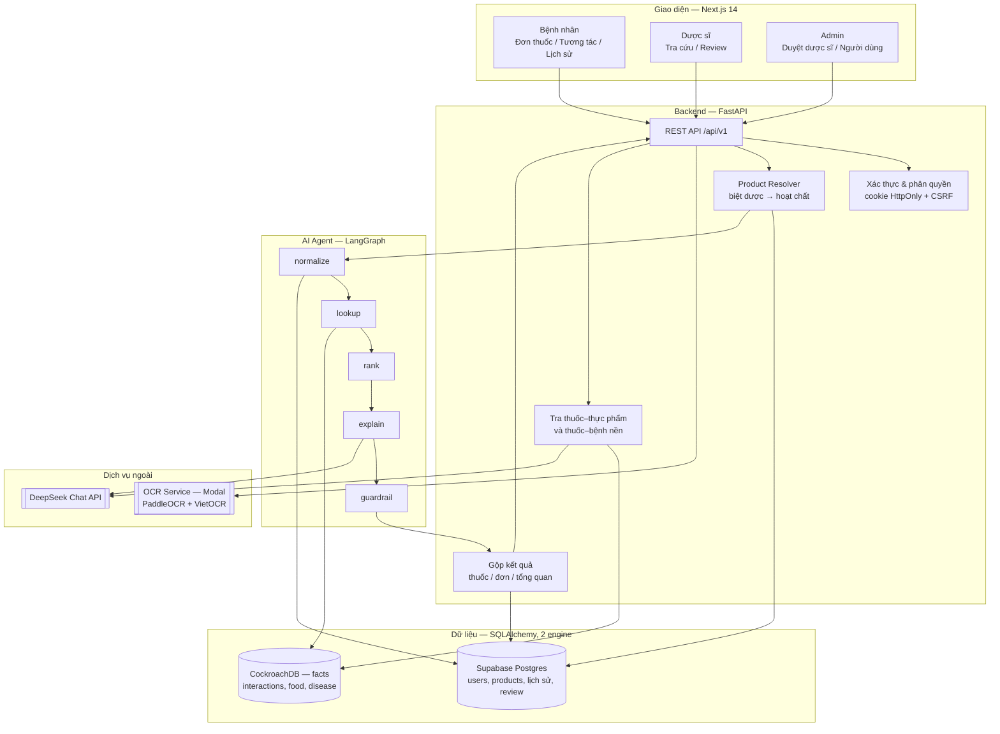
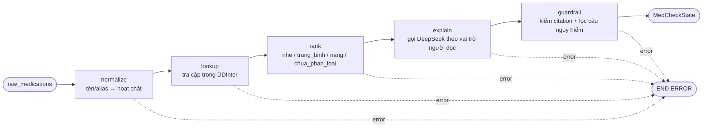
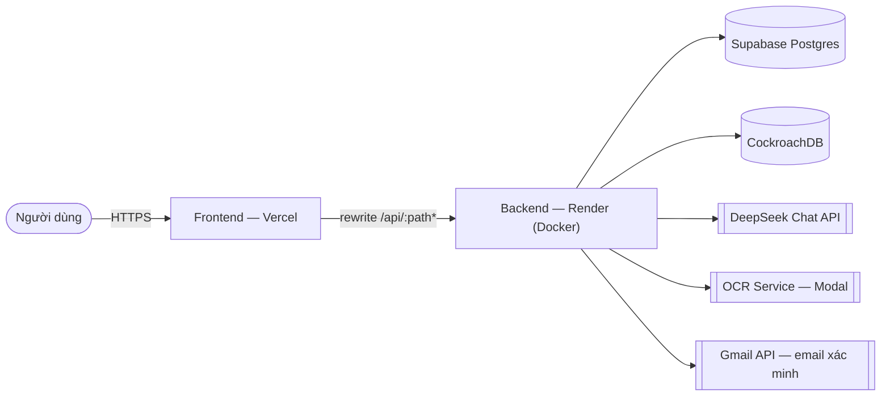

# Kiến trúc hệ thống — MediCheck (VMEC-12)

> Deliverable #3. Sơ đồ hệ thống + mô tả thành phần. Số liệu và tên dịch vụ trong tài
> liệu này khớp với bản đang chạy tại https://ai20k-c3-team005-medicheck.vercel.app
> (cập nhật 01/09/2026).

MediCheck nhận danh sách thuốc (gõ tên biệt dược/hoạt chất, hoặc chụp ảnh đơn thuốc cho
service OCR đọc), phân giải biệt dược → hoạt chất, rồi chạy **LangGraph agent 5 node** để
chuẩn hóa, tra cứu DDInter 2.0, xếp hạng mức độ và sinh giải thích tiếng Việt kèm trích
dẫn. Cùng lượt kiểm tra còn tra thêm **tương tác thuốc–thực phẩm** và **thuốc–bệnh nền**
bằng SQL thuần (ngoài agent). Kết quả đi qua guardrail an toàn y tế, được gộp theo
thuốc/đơn/tổng quan, lưu lại cho bệnh nhân và đưa vào hàng đợi để **dược sĩ xác nhận**
(human-in-the-loop).

## 1. Sơ đồ hệ thống

## 2. Thành phần chính

| Thành phần | Công nghệ | Vai trò | Vị trí |
|---|---|---|---|
| Frontend | Next.js 14 App Router + TypeScript | 3 vai trò (bệnh nhân / dược sĩ / admin), session bằng cookie HttpOnly | [`frontend/`](../frontend/) |
| Backend API | FastAPI + Uvicorn + Pydantic | REST `/api/v1`, xác thực, phân quyền, điều phối agent | [`src/api/routes.py`](../src/api/routes.py) |
| AI Agent | LangGraph + LangChain | Pipeline 5 node cho tương tác thuốc–thuốc | [`src/agents/graph.py`](../src/agents/graph.py) |
| Agent tools | Python + SQLAlchemy | `drug_normalizer`, `interaction_lookup`, `severity_ranker` | [`src/agents/tools/`](../src/agents/tools/) |
| Thuốc–thực phẩm / thuốc–bệnh nền | SQL thuần, chạy ngoài agent | Tra theo từng hoạt chất; lọc theo bệnh nền đã khai của bệnh nhân | [`src/services/food_disease_lookup.py`](../src/services/food_disease_lookup.py) |
| LLM | DeepSeek-chat qua `langchain-openai` | Chỉ **diễn giải** dữ liệu đã tra được, không tự sinh dữ liệu tương tác | [`src/services/llm.py`](../src/services/llm.py) |
| OCR đơn thuốc | Service tách riêng, PaddleOCR + VietOCR | Ảnh → ứng viên tên thuốc/bệnh để người dùng xác nhận | [`ocr-service/`](../ocr-service/) |
| Database | Supabase Postgres + CockroachDB | 22 bảng, xem §4 | [`src/db/`](../src/db/) |

## 3. Pipeline AI Agent

Mỗi node ghi kết quả vào `MedCheckState` ([`src/agents/state.py`](../src/agents/state.py)).
Node nào set `error` thì graph dừng sớm — agent **không bịa** tương tác khi thiếu dữ liệu
mà trả cờ báo thiếu. Guardrail chặn mọi ngôn ngữ khuyên tự ý đổi/ngừng/chỉnh liều và loại
đoạn giải thích không có `nguon_trich_dan`.

## 4. Dữ liệu

Hai engine SQLAlchemy, tách vì 3 bảng tra cứu chiếm >95% dung lượng và vượt quota 0.5 GB
của Supabase free tier — chi tiết ở [`database-split.md`](database-split.md).

| Engine | Biến môi trường | Nội dung |
|---|---|---|
| Chính | `DATABASE_URL` — Supabase Postgres | `users`, `patient_profiles`, `patient_conditions`, `products`, `medications`, `patient_prescriptions`, `interaction_checks`, `pharmacist_reviews`, `notifications`, cache giải thích, `feedback_reports`… |
| Facts | `DATABASE_URL_FACTS` — CockroachDB | `interactions`, `food_interactions`, `disease_interactions` |

Số liệu production (01/09/2026):

| Dữ liệu | Bản ghi |
|---|---:|
| Tương tác thuốc–thuốc (DDInter 2.0) | 160.227 cặp / 1.939 hoạt chất |
| Tương tác thuốc–bệnh nền | 7.672 (trên 450 bệnh) |
| Tương tác thuốc–thực phẩm | 803 |
| Biệt dược Việt Nam → hoạt chất | 41.302 / 68.562 |

ETL: [`scripts/import_ddinter.py`](../scripts/import_ddinter.py),
[`import_ddinter_dfi_ddsi.py`](../scripts/import_ddinter_dfi_ddsi.py),
[`import_products.py`](../scripts/import_products.py).
SQLite (`data/app.db`) vẫn dùng được cho dev offline khi để trống `DATABASE_URL_FACTS`.

## 5. Luồng một lần kiểm tra

1. Người dùng nhập biệt dược, hoặc upload ảnh đơn → OCR Service trả ứng viên để xác nhận.
2. Backend kiểm tra quyền, phân giải biệt dược → hoạt chất (`products` / `product_ingredients`).
3. Agent chạy 5 node; `explain` gọi DeepSeek với giọng điệu theo vai trò người đọc.
4. Song song: tra thuốc–thực phẩm và thuốc–bệnh nền, sinh giải thích riêng cho 2 nhóm.
5. Gộp kết quả theo hoạt chất → thuốc → đơn → tổng quan (`asyncio.gather` cho 4 nhánh LLM).
6. Luồng bệnh nhân: lưu `interaction_checks`; bệnh nhân có thể gửi yêu cầu dược sĩ xác nhận.
7. Dược sĩ xem bản đầy đủ (có `xu_tri`, thuốc thay thế), xác nhận + ghi chú → bệnh nhân nhận thông báo.

## 6. Triển khai

- Trình duyệt **không** gọi thẳng backend: `frontend/next.config.js` rewrite `/api/:path*`
  ở tầng server nên production chỉ lộ một origin, cookie phiên là same-site.
- Backend chạy free tier → **request đầu sau thời gian nghỉ mất 30–60 giây** (cold start),
  các request sau dưới 1 giây.
- CI/CD: push nhánh `feature/production` → GitHub Actions (self-hosted runner của BTC)
  chạy ruff + pytest → build image lên GHCR + deploy hook Render → `vercel deploy --prod`
  ([`.github/workflows/cd.yml`](../.github/workflows/cd.yml)).
- Local: `docker compose up --build` chạy `frontend` (:3000), `backend` (:8000) và `ocr`
  (chỉ mạng nội bộ). Thiếu `data/raw/thuoc_final_project.csv` thì `ocr` không healthy và
  backend không khởi động — chạy `docker compose up --no-deps backend frontend` để bỏ OCR.

## 7. An toàn & bảo mật

- Phiên đăng nhập: JWT trong cookie `HttpOnly` (access + refresh có xoay vòng), kèm CSRF
  token cho mọi request thay đổi dữ liệu; không lưu credential trong `localStorage`.
- Phân quyền theo vai trò `patient` / `pharmacist` / `admin`; tài khoản dược sĩ chỉ hoạt
  động sau khi admin duyệt số CCHN và nơi công tác.
- Thông tin chuyên môn (`xu_tri`, `thay_the_a`, `thay_the_b`) chỉ trả về cho luồng dược sĩ.
- Guardrail chặn nội dung khuyên tự ý đổi/ngừng/chỉnh liều thuốc.
- `validate_production_auth_settings()` chặn khởi động ở `APP_ENV=production` nếu thiếu
  `SECRET_KEY` mạnh, `COOKIE_SECURE`, Google Client ID, cấu hình email hoặc CORS hợp lệ.
- Service OCR không publish ra host khi chạy local; bản Modal bật proxy auth
  (`MODAL_KEY_ID` / `MODAL_KEY_SECRET`).
- Secret chỉ nằm trong `.env`; ảnh đơn thuốc chứa thông tin bệnh nhân không bao giờ commit.

## 8. Quyết định thiết kế

| Quyết định | Lựa chọn | Lý do |
|---|---|---|
| Backend | FastAPI | Async, Swagger tự sinh, hợp với Pydantic |
| Agent | LangGraph | State rõ ràng, dừng sớm khi thiếu dữ liệu |
| LLM | DeepSeek qua API tương thích OpenAI | Giải thích tiếng Việt, chi phí thấp; `temperature=0.3` sau kết quả eval |
| Database | Supabase + CockroachDB | Dùng chung cho cả team; tách bảng tra cứu vì quota free tier |
| OCR | Service riêng trên Modal | Image ~4 GB, ~2 GB RAM; scale-to-zero nên chỉ tốn credit khi có ảnh |
| Deploy | Vercel + Render | Live URL public, deploy tự động từ nhánh `feature/production` |
| An toàn | Human-in-the-loop | Cảnh báo chỉ đáng tin sau khi dược sĩ xác nhận |

## 9. Giới hạn hiện tại

- Hai DB tách rời nên không JOIN chéo được; phần ghép tên hoạt chất cho tương tác thực
  phẩm/bệnh nền phải làm trong Python.
- Chưa dùng framework migration (chỉ `create_all` + vá cột thủ công trong `session.py`).
- Bệnh nhân tự chọn dược sĩ; chưa có phân công/hàng đợi tự động.
- Guardrail kết thúc bằng success/error, chưa có vòng lặp rewrite tự động trong LangGraph.
- ChromaDB có sẵn service module nhưng chưa dùng trong luồng kiểm tra chính.
- Faithfulness và Safety trên tập held-out chưa đạt ngưỡng đề ra — xem
  [`evaluation.md`](evaluation.md).
