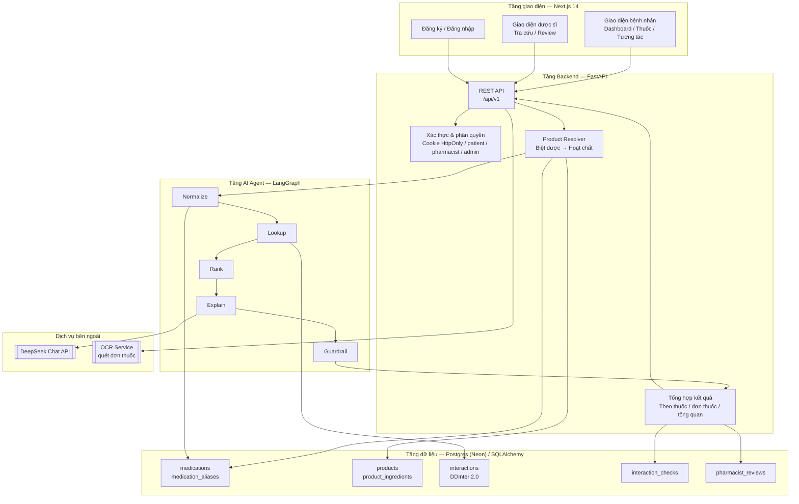
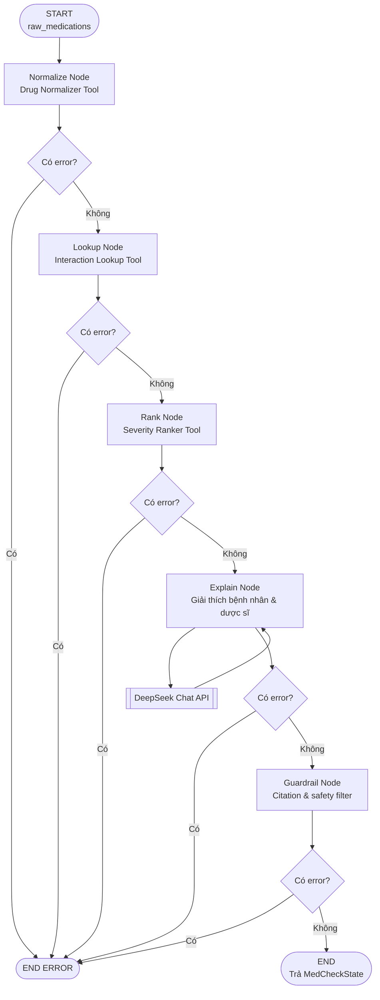
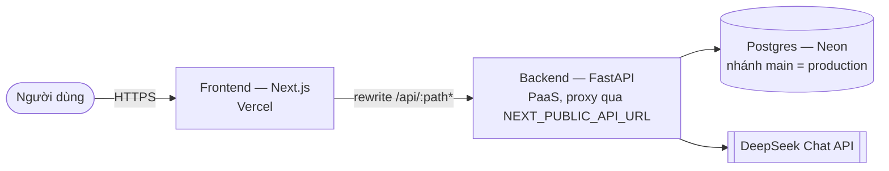

# Architecture Diagram — MediCheck (VMEC-12)

> Deliverable #3. Sơ đồ hệ thống + mô tả component. Bản đặc tả kiến trúc đầy đủ
> (data flow chi tiết, security, design decisions, giới hạn hiện tại):
> [`../ARCHITECTURE.md`](../ARCHITECTURE.md).

MediCheck nhận danh sách thuốc (tên biệt dược hoặc hoạt chất), phân giải thành hoạt chất
chuẩn, tra cứu cặp tương tác trong CSDL DDInter 2.0, xếp hạng mức độ nghiêm trọng, sinh
giải thích tiếng Việt kèm trích dẫn nguồn, rồi lọc qua guardrail an toàn y tế trước khi
trả về. Với luồng bệnh nhân, kết quả được lưu lại để dược sĩ xác nhận (human-in-the-loop).

## 1. System Overview

## 2. Agent Flow — pipeline 5 node

Mỗi node ghi kết quả vào `MedCheckState`. Node nào set `error` thì graph dừng sớm — agent
không bao giờ "bịa" tương tác khi thiếu dữ liệu, mà trả cờ báo thiếu.

## 3. Component Details

| Component | Công nghệ | Vai trò | Vị trí trong repo |
|---|---|---|---|
| Frontend | Next.js 14 App Router + TypeScript | 2 vai trò (bệnh nhân/dược sĩ), session qua cookie HttpOnly | [`frontend/`](../frontend/) |
| Backend API | FastAPI + Uvicorn | REST `/api/v1`, xác thực, phân quyền, điều phối agent | [`src/api/routes.py`](../src/api/routes.py) |
| AI Agent | LangGraph + LangChain | Pipeline 5 node: normalize → lookup → rank → explain → guardrail | [`src/agents/graph.py`](../src/agents/graph.py) |
| Agent tools | Python | `drug_normalizer`, `interaction_lookup`, `severity_ranker` | [`src/agents/tools/`](../src/agents/tools/) |
| LLM | DeepSeek-chat qua `langchain-openai` | Chỉ sinh **giải thích** dựa trên dữ liệu đã tra cứu, không tự sinh dữ liệu tương tác | [`src/services/llm.py`](../src/services/llm.py) |
| Database | Postgres (Neon) / SQLite dev, SQLAlchemy | 9 bảng chính: `medications`, `interactions`, `products`, `interaction_checks`, `pharmacist_reviews`, … | [`src/db/models.py`](../src/db/models.py) |
| Dữ liệu nguồn | DDInter 2.0 | 1.503 hoạt chất / 15.140 cặp tương tác thật, kèm trích dẫn y văn | [`scripts/import_ddinter.py`](../scripts/import_ddinter.py) |
| OCR Service | Service tách riêng | Quét đơn thuốc ảnh → danh sách thuốc | [`ocr-service/`](../ocr-service/) |

## 4. Deployment

Frontend không gọi thẳng backend từ trình duyệt: `frontend/next.config.js` rewrite
`/api/:path*` sang `NEXT_PUBLIC_API_URL` ở tầng server, nên domain production chỉ lộ một
origin duy nhất.

**Live URL:** https://ai20k-c3-team005-medicheck.vercel.app

Bản chạy local bằng Docker Compose (frontend `:3000` + backend `:8000` + SQLite mount từ
host) mô tả trong [`../ARCHITECTURE.md`](../ARCHITECTURE.md) §6 và [`../README.md`](../README.md).

## 5. Data Flow — tóm tắt

1. Người dùng nhập danh sách biệt dược (hoặc upload ảnh đơn → OCR Service).
2. Backend phân giải biệt dược → hoạt chất qua `products` / `product_ingredients`.
3. Agent chuẩn hóa tên, tra `interactions` (DDInter 2.0) theo từng cặp hoạt chất.
4. Xếp hạng `nhe` / `trung_binh` / `nang` / `chua_phan_loai`.
5. DeepSeek sinh giải thích tiếng Việt — **chỉ từ dữ liệu đã tra được**, kèm `nguon_trich_dan`.
6. Guardrail chặn ngôn ngữ nguy hiểm (tự ý ngừng/đổi thuốc) và kiểm tra citation không rỗng.
7. Kết quả roll-up theo thuốc/đơn/tổng quan, lưu vào `interaction_checks`, dược sĩ xác nhận.

Chi tiết từng bước kèm sơ đồ sequence: [`../ARCHITECTURE.md`](../ARCHITECTURE.md) §4.
