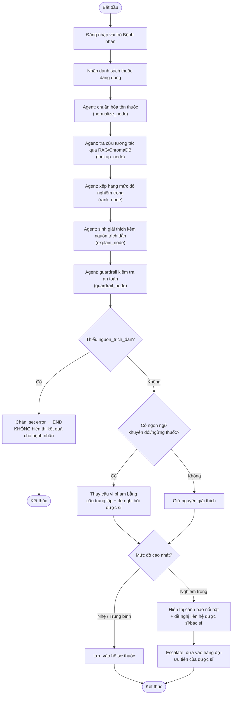
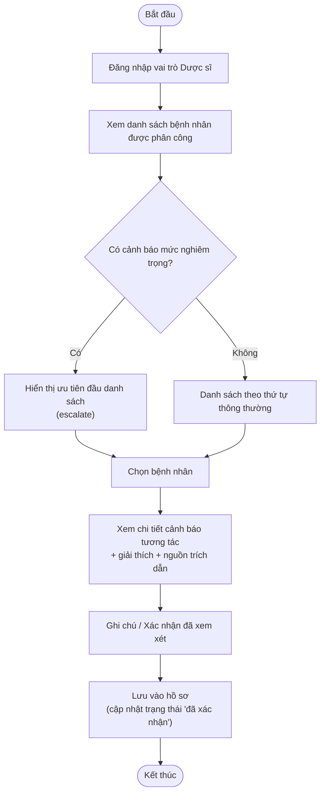
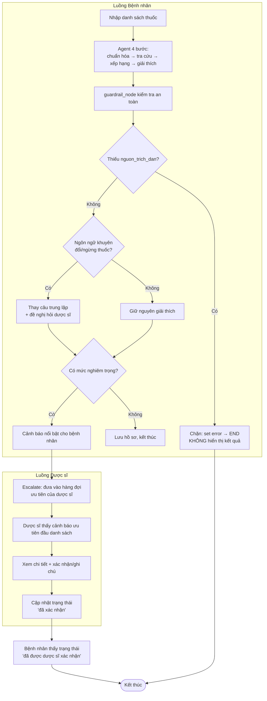

# GIAI ĐOẠN 3: THIẾT KẾ UI/UX
## Đề tài VMEC-12 — MedGuard AI

---

## 0. Ghi chú khớp code thật
**Quyết định frontend đã CHỐT: Next.js** (không còn là lựa chọn mở giữa Next.js/Streamlit như bản trước). Khung code frontend đã có sẵn trong repo theo đúng 2 vai trò: `frontend/app/(patient)/` (`dashboard`, `medications`, `check-result`) và `frontend/app/(pharmacist)/` (`patients`, `review`), cùng `frontend/components/AlertCard.tsx` và `frontend/lib/api.ts` gọi API backend. Toàn bộ wireframe/user flow dưới đây áp dụng trực tiếp cho cấu trúc route Next.js đã có này.

---

## 1. User Flow

### 1.1 Luồng bệnh nhân
Đăng nhập (vai trò bệnh nhân) → Nhập danh sách thuốc đang dùng → Agent kiểm tra (chuẩn hóa tên → tra cứu tương tác → xếp hạng mức độ) → Xem kết quả:
- Nếu **nhẹ/trung bình** → lưu vào hồ sơ thuốc, không cần hành động thêm.
- Nếu **nghiêm trọng** → cảnh báo nổi bật, đề nghị liên hệ dược sĩ/bác sĩ ngay.

### 1.2 Luồng dược sĩ
Đăng nhập (vai trò dược sĩ) → Xem danh sách bệnh nhân được phân công → Xem cảnh báo tương tác theo từng bệnh nhân → Xác nhận/ghi chú → Lưu vào hồ sơ. Nếu có cảnh báo mức nghiêm trọng, dược sĩ nhận thông báo ưu tiên (escalate).

### 1.3 Luồng hoạt động chung (Bệnh nhân + Dược sĩ)
Điểm nối giữa 2 luồng là bước **escalate**: khi agent phát hiện tương tác mức "nặng", bệnh nhân thấy cảnh báo ngay, đồng thời hồ sơ được đẩy vào hàng đợi ưu tiên của dược sĩ phụ trách. Dược sĩ xử lý xong thì trạng thái "đã xác nhận" phản hồi ngược lại cho bệnh nhân — khớp với US-04 (GĐ2) và Kịch bản beta test 2 (GĐ5).

---

## 2. Wireframe — mô tả từng màn hình

### Vai trò Bệnh nhân
| Màn hình | Thành phần chính |
|---|---|
| Đăng nhập | Logo, ô email/mật khẩu, nút đăng nhập, link "Quên mật khẩu" |
| Trang chủ (Dashboard) | Danh sách thuốc đang dùng, nút "Thêm thuốc", nút "Kiểm tra tương tác", lịch sử kiểm tra gần nhất |
| Thêm/sửa thuốc | Ô tìm kiếm/nhập tên thuốc (có gợi ý tự động), ngày bắt đầu dùng, nút lưu |
| Kết quả cảnh báo | Danh sách thuốc đã nhập, thẻ cảnh báo theo từng mức độ (màu sắc phân biệt), giải thích + nguồn, nút "Liên hệ dược sĩ" nếu nghiêm trọng *(đã có mockup ở trên)* |
| Hồ sơ thuốc / Lịch sử | Danh sách các lần kiểm tra trước đó, trạng thái đã được dược sĩ xác nhận hay chưa |

### Vai trò Dược sĩ
| Màn hình | Thành phần chính |
|---|---|
| Đăng nhập | Tương tự bệnh nhân nhưng chọn vai trò dược sĩ |
| Danh sách bệnh nhân | Danh sách bệnh nhân phụ trách, badge số cảnh báo chưa xử lý, sắp xếp theo mức độ ưu tiên |
| Chi tiết cảnh báo bệnh nhân | Danh sách thuốc, các cảnh báo tương tác, ô ghi chú, nút "Xác nhận đã xem xét" |
| Thông báo ưu tiên | Danh sách các cảnh báo mức nghiêm trọng cần xử lý gấp, hiển thị nổi bật trên đầu trang chủ dược sĩ |

---

## 3. Design System

### 3.1 Màu sắc (ý nghĩa sử dụng)
| Vai trò màu | Ý nghĩa | Áp dụng |
|---|---|---|
| Xanh dương (accent) | Hành động chính, điều hướng | Nút chính, link |
| Đỏ (danger) | Cảnh báo mức nghiêm trọng | Thẻ cảnh báo "nặng" |
| Vàng/cam (warning) | Cảnh báo mức trung bình | Thẻ cảnh báo "trung bình" |
| Xám (neutral) | Thông tin trung tính, mức nhẹ | Thẻ cảnh báo "nhẹ", nền phụ |

### 3.2 Typography
- Font chính: sans-serif rõ ràng, dễ đọc (ưu tiên khả năng đọc cho người lớn tuổi — cỡ chữ tối thiểu 15px cho nội dung chính, không dùng chữ dưới 13px).
- Tiêu đề: đậm vừa phải (medium weight), không dùng chữ hoa toàn bộ.
- Nội dung cảnh báo y tế: luôn ưu tiên độ tương phản cao, không dùng màu nhạt cho chữ cảnh báo nghiêm trọng.

### 3.3 Nguyên tắc UI đặc thù cho sản phẩm y tế
- **Không bao giờ** dùng màu sắc đơn thuần để truyền tải mức độ nghiêm trọng — luôn kèm icon + chữ mô tả (vì có người dùng mù màu).
- Disclaimer "chỉ mang tính tham khảo, không thay thế tư vấn y khoa" phải xuất hiện ở **mọi** màn hình có cảnh báo.
- Nút hành động khẩn cấp ("Liên hệ dược sĩ/bác sĩ") phải luôn hiển thị rõ ràng, không ẩn trong menu phụ.
- Form nhập thuốc nên có gợi ý tự động (autocomplete) để giảm sai sót khi gõ tên thuốc.

### 3.4 Component chuẩn dùng lại
- Thẻ cảnh báo (Alert card): icon + mức độ + mô tả + nguồn trích dẫn — dùng chung cho cả bệnh nhân và dược sĩ.
- Badge trạng thái: "Chưa xác nhận" / "Đã xác nhận" / "Cần xử lý gấp".
- Card thông tin thuốc: tên thuốc, ngày bắt đầu dùng, nút sửa/xóa.

---
*Tài liệu tiếp theo: Giai đoạn 4 — Phát triển MVP (kiến trúc kỹ thuật chi tiết, setup dự án, xây dựng agent).*
