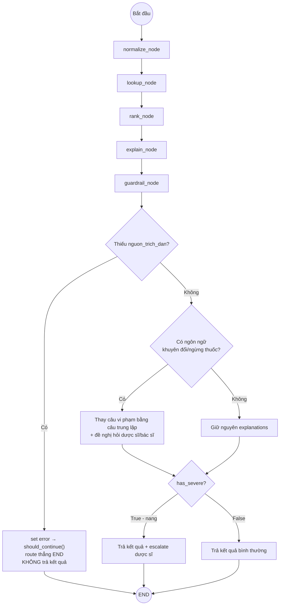

# GIAI ĐOẠN 4: PHÁT TRIỂN (DEVELOPMENT — XÂY MVP)
## Đề tài VMEC-12 — MedGuard AI
### (Đã cập nhật bám sát code thật: AI20K Agent Template — repo P-005)

---

## 0. Ghi chú quan trọng
Tài liệu này thay thế bản Giai đoạn 4 trước đó. Toàn bộ kiến trúc dưới đây được thiết kế **để khớp trực tiếp** với cấu trúc code, quy ước đặt tên, và tech stack đã có sẵn trong repo template (`src/agents/`, `src/api/`, `src/models/`, `src/services/`, `src/config.py`), thay vì kiến trúc tự do đề xuất ban đầu.

---

## 1. Tech stack thực tế (theo `requirements.txt` + `README.md` của template)

| Layer | Công nghệ | Ghi chú |
|---|---|---|
| Agent orchestration | LangGraph + LangChain | Có sẵn `src/agents/graph.py` |
| LLM | OpenAI GPT-4o-mini (`langchain-openai`) | Cấu hình qua `config.py` (`model_name`, `openai_api_key`) |
| Backend | FastAPI + Uvicorn | Có sẵn `src/main.py`, `src/api/routes.py` |
| Database | SQLite (dev) → PostgreSQL (prod) | `database_url` trong `config.py`; cần bật `sqlalchemy`/`psycopg2-binary` trong `requirements.txt` (hiện đang comment) |
| Vector Store | ChromaDB | `chroma_persist_dir` đã có trong `config.py`; cần bật `chromadb` trong `requirements.txt` |
| Frontend | Next.js hoặc Streamlit | Theo README, chưa có code sẵn — cần tự xây |
| Testing | pytest + pytest-asyncio + httpx | Có sẵn `tests/conftest.py`, mẫu test trong `tests/test_agents/`, `tests/test_api/` |
| DevOps | Docker + GitHub Actions | Có sẵn `Dockerfile`, `docker-compose.yml`, `.github/workflows/` |
| AI Usage Logging | Hooks tự động (Claude Code, Cursor, Codex, Gemini CLI...) | Bắt buộc chạy `bash scripts/setup_hooks.sh` sau khi bắt đầu code |

**Việc cần làm ngay ở Sprint 0:** mở `requirements.txt`, bỏ comment các dòng `sqlalchemy`, `psycopg2-binary` (hoặc giữ SQLite nếu chưa cần Postgres), và `chromadb` — vì đề tài VMEC-12 bắt buộc dùng RAG trên CSDL tương tác thuốc.

---

## 2. Ánh xạ kiến trúc VMEC-12 vào đúng cấu trúc thư mục có sẵn

```
src/
├── agents/
│   ├── graph.py            → build_graph(): nối 5 node MedGuard theo đúng pattern add_node/add_edge của mẫu
│   ├── state.py             → thay AgentState mẫu bằng MedCheckState (xem mục 3)
│   ├── nodes/
│   │   ├── normalize_node.py   → chuẩn hóa tên thuốc (thay cho example_node.py)
│   │   ├── lookup_node.py      → tra cứu tương tác qua RAG/ChromaDB
│   │   ├── rank_node.py        → xếp hạng mức độ nghiêm trọng
│   │   ├── explain_node.py     → sinh giải thích có trích nguồn
│   │   └── guardrail_node.py   → chặn hallucination + chặn khuyên đổi thuốc
│   └── tools/
│       ├── drug_normalizer_tool.py   → @tool chuẩn hóa tên (thay example_tool.py)
│       ├── interaction_lookup_tool.py → @tool tra cứu ChromaDB
│       └── severity_ranker_tool.py    → @tool xếp mức độ
├── api/
│   └── routes.py            → thêm endpoint mới cạnh /chat, /status có sẵn (xem mục 4)
├── models/
│   └── schemas.py           → thêm MedicationCheckRequest/Response cạnh ChatRequest/Response có sẵn
├── services/
│   ├── llm.py                → dùng nguyên get_llm() có sẵn, không đổi
│   └── vector_store.py       → MỚI: khởi tạo ChromaDB, load CSDL thuốc mô phỏng
└── config.py                 → dùng nguyên Settings có sẵn, chỉ thêm field nếu cần (VD: severity_threshold)
```

**Nguyên tắc:** giữ nguyên toàn bộ pattern đã có (`AgentState` → đổi field, không đổi kiểu `TypedDict, total=False`; node là `async def` nhận `state` trả về `dict` như `analyze_node`/`respond_node`; tool dùng decorator `@tool` từ `langchain_core.tools` như `example_tool.py`).

---

## 3. State schema — thay thế `AgentState` mẫu

Theo đúng style hiện có (`TypedDict, total=False`), state cho MedGuard AI:

```python
# src/agents/state.py
from __future__ import annotations
from typing import TypedDict


class MedCheckState(TypedDict, total=False):
    """State schema cho LangGraph agent kiểm tra tương tác thuốc."""

    raw_medications: list[str]          # input thô: tên thuốc người dùng nhập
    normalized_medications: list[dict]  # sau khi chuẩn hóa tên
    interaction_results: list[dict]     # kết quả tra cứu thô từ ChromaDB
    ranked_results: list[dict]          # đã gán mức độ nghiêm trọng
    explanations: list[dict]            # giải thích cuối, có nguon_trich_dan
    has_severe: bool                    # cờ escalate cho dược sĩ
    error: str                          # giữ nguyên field error như mẫu, dùng cho routing lỗi
    metadata: dict                      # giữ nguyên như mẫu
```

---

## 4. Node design — theo đúng pattern `example_node.py`

Mẫu gốc dùng `async def <ten>_node(state: AgentState) -> dict`. Áp dụng y hệt:

| Node (file) | Vai trò | Input field đọc | Output field ghi |
|---|---|---|---|
| `normalize_node` | Gọi tool `drug_normalizer_tool` để chuẩn hóa tên thuốc | `raw_medications` | `normalized_medications` |
| `lookup_node` | Gọi tool `interaction_lookup_tool`, truy vấn ChromaDB (RAG) | `normalized_medications` | `interaction_results` |
| `rank_node` | Gọi tool `severity_ranker_tool` | `interaction_results` | `ranked_results`, `has_severe` |
| `explain_node` | Gọi LLM (`get_llm()` có sẵn trong `services/llm.py`) sinh giải thích, bắt buộc kèm nguồn | `ranked_results` | `explanations` |
| `guardrail_node` | Kiểm tra citation (thiếu → set `error`) + chặn ngôn ngữ khuyên đổi thuốc (vi phạm → sanitize, không set `error`) — chi tiết mục 4.5 | `explanations` | `explanations` (đã lọc) hoặc `error` |

**Routing lỗi**: dùng lại đúng cơ chế `should_continue()` có sẵn trong `graph.py` — nếu `state.get("error")` có giá trị → route thẳng tới `END` (giống hệt logic gốc), đảm bảo không trả kết quả sai cho người dùng khi guardrail phát hiện vi phạm.

### 4.5 Luồng hoạt động end-to-end

`guardrail_node` xử lý **2 loại vi phạm khác nhau**, không gộp chung một nhánh lỗi:
- **Thiếu `nguon_trich_dan`** (nguy cơ hallucination) → set `error`, `should_continue()` route thẳng tới `END`, **không trả bất kỳ kết quả nào** cho người dùng.
- **Ngôn ngữ khuyên đổi/ngừng thuốc** → **không** set `error`; chỉ thay câu vi phạm bằng câu trung lập + đề nghị hỏi dược sĩ/bác sĩ, rồi **vẫn tiếp tục** trả kết quả bình thường (đã kiểm chứng ở TC-N07/TC-N08, `tests/test_agents/test_graph.py`).



*(Ghi chú: `should_continue()` được áp trên conditional edge sau **mỗi** node từ `normalize` đến `guardrail` để bất kỳ node nào cũng có thể short-circuit tới `END` nếu set `error` — nhưng ở bản hiện tại chỉ `guardrail_node` thực sự set `error`, nên sơ đồ trên chỉ vẽ nhánh rẽ tại bước guardrail cho gọn.)*

---

## 5. Tool design — theo đúng pattern `example_tool.py`

Mẫu gốc dùng decorator `@tool` từ `langchain_core.tools`, docstring có `Args:`/`Returns:`. Áp dụng:

```python
# src/agents/tools/interaction_lookup_tool.py
from langchain_core.tools import tool

@tool
def interaction_lookup(medication_names: list[str]) -> str:
    """Tra cứu tương tác thuốc giữa các thuốc trong danh sách qua ChromaDB.

    Args:
        medication_names: Danh sách tên thuốc đã chuẩn hóa

    Returns:
        Chuỗi JSON chứa các cặp tương tác tìm thấy kèm nguồn trích dẫn.
        Nếu không tìm thấy, trả về "khong_du_du_lieu": true cho cặp đó.
    """
    # TODO: query ChromaDB (services/vector_store.py) thay cho logic mẫu
    ...
```

Tương tự cho `drug_normalizer_tool` (chuẩn hóa tên viết tắt/biệt dược) và `severity_ranker_tool` (gán `nhe`/`trung_binh`/`nang`).

---

## 6. `services/vector_store.py` — thành phần mới cần thêm

Template chưa có sẵn file này (chỉ có `chroma_persist_dir` trong `config.py`). Cần tạo mới theo đúng style của `services/llm.py` (hàm factory đơn giản, đọc từ `get_settings()`):

```python
# src/services/vector_store.py
import chromadb
from src.config import get_settings

def get_vector_store():
    settings = get_settings()
    client = chromadb.PersistentClient(path=settings.chroma_persist_dir)
    return client.get_or_create_collection("medication_interactions")
```

Dữ liệu nạp vào collection này là CSDL thuốc & tương tác **mô phỏng** (cấu trúc kiểu DrugBank/RxNorm) đã chốt ở Giai đoạn 1–2, được embed và seed một lần khi setup.

---

## 7. API routes — mở rộng `routes.py` có sẵn

Giữ nguyên `/chat` và `/status` mẫu (có thể dùng `/chat` để test nhanh agent), thêm endpoint chuyên biệt:

| Endpoint | Method | Mô tả |
|---|---|---|
| `/api/v1/medications/check` | POST | Nhận danh sách thuốc, chạy `agent.ainvoke()` với `MedCheckState`, trả `ranked_results` + `explanations` |
| `/api/v1/pharmacist/reviews` | POST | Dược sĩ xác nhận/ghi chú một kết quả kiểm tra (theo đúng field `pharmacist_reviews` đã thiết kế ở GĐ2) |

Schema tương ứng thêm vào `models/schemas.py` cạnh `ChatRequest`/`ChatResponse`:
```python
class MedicationCheckRequest(BaseModel):
    medications: list[str] = Field(..., min_length=1)

class MedicationCheckResponse(BaseModel):
    ranked_results: list[dict]
    explanations: list[dict]
    has_severe: bool
```

---

## 8. Testing — bám theo `tests/conftest.py` và mẫu có sẵn

- `tests/test_agents/test_graph.py`: viết theo đúng mẫu (`agent.ainvoke({...})`, assert các field trong `MedCheckState` thay vì `AgentState`).
- `tests/test_api/test_routes.py`: dùng fixture `client` có sẵn, thêm test cho `/medications/check`.
- Dùng lại fixture `mock_llm` có sẵn trong `conftest.py` để test guardrail mà không tốn API call thật — **rất quan trọng** để test case "chặn khuyên đổi thuốc" và "chặn hallucination khi thiếu dữ liệu" chạy nhanh, không phụ thuộc OpenAI.

---

## 9. Đối chiếu với 10 Deliverables của Demo Day (theo README template)

| # | Deliverable | Đã có sẵn khung? | Việc cần làm cho VMEC-12 |
|---|---|---|---|
| 1 | Source Code (`src/`) | ✅ khung có sẵn | Điền logic 5 node + 3 tool như mục 4–5 |
| 2 | README.md | 📝 template | Copy `README_boilerplate.md` → viết lại theo MedGuard AI |
| 3 | Architecture Diagram | 📝 template có sẵn ở `docs/architecture_diagram.md`, `ARCHITECTURE.md` | Điền đúng nội dung MedGuard AI vào các mục `[mô tả]` còn trống |
| 4 | AI Logs | ✅ hook tự động | Chạy `bash scripts/setup_hooks.sh` ngay từ đầu |
| 5 | Live URL | ⚡ CI/CD sẵn | Deploy khi hoàn thiện Sprint 3 |
| 6 | Video Demo | 📝 | Quay ở cuối Sprint 5 |
| 7 | Pitch Deck | 📝 | Làm ở Giai đoạn 6 (trình bày khách hàng) |
| 8 | Development Journal | ✅ `JOURNAL.md` | Cập nhật liên tục theo từng sprint |
| 9 | Worklog | ✅ `WORKLOG.md` | Cập nhật liên tục |
| 10 | Evaluation Evidence | 📝 `eval/results/report.md` có sẵn khung | Điền kết quả test guardrail, độ chính xác chuẩn hóa tên thuốc, thời gian phản hồi |

---

## 10. Kế hoạch sprint đã cập nhật (bám code thật)

| Sprint | Việc cụ thể |
|---|---|
| Sprint 0 | Bật `chromadb`, `sqlalchemy` trong `requirements.txt`; chạy `scripts/setup_hooks.sh`; seed CSDL thuốc mô phỏng vào ChromaDB qua `services/vector_store.py` |
| Sprint 1 | Viết 5 node (`nodes/`) + 3 tool (`tools/`) thay thế `example_node.py`/`example_tool.py`; cập nhật `state.py` → `MedCheckState`; cập nhật `graph.py` |
| Sprint 2 | Thêm endpoint `/medications/check`, `/pharmacist/reviews` vào `routes.py` + `schemas.py`; bắt đầu frontend Next.js 2 vai trò |
| Sprint 3 | Hoàn thiện `guardrail_node`, viết test theo `tests/test_agents/`, `tests/test_api/`; điền `ARCHITECTURE.md` |
| Sprint 4 (nâng cao) | OCR đơn thuốc, tương tác thuốc–bệnh nền |
| Sprint 5 | Chạy eval, điền `eval/results/report.md`, deploy, quay video demo |

---
*Tài liệu tiếp theo: Giai đoạn 5 — Kiểm thử (QA/Testing): test plan, test case, kịch bản beta test — bám theo `tests/` có sẵn trong repo.*
